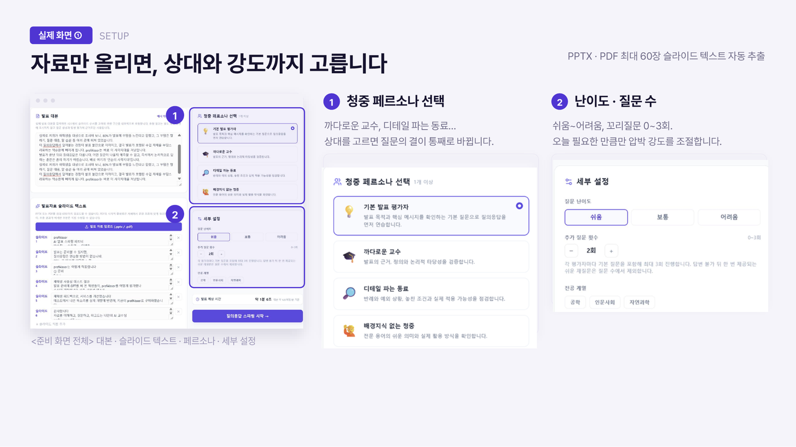
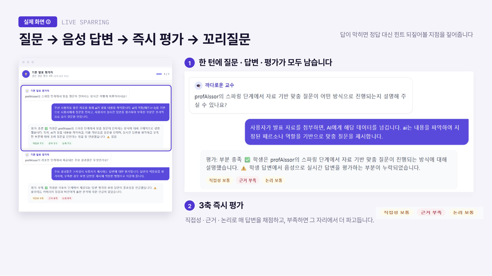
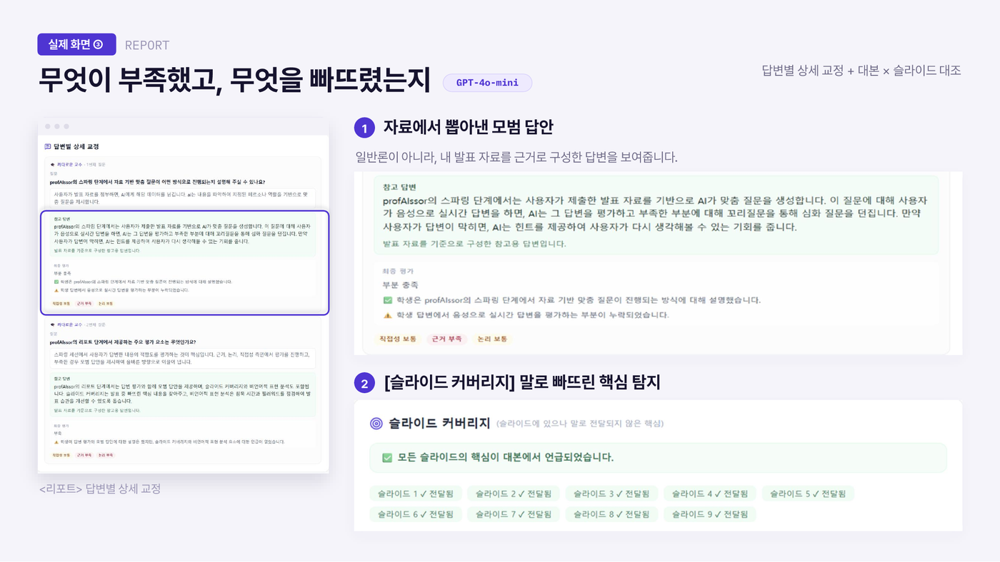
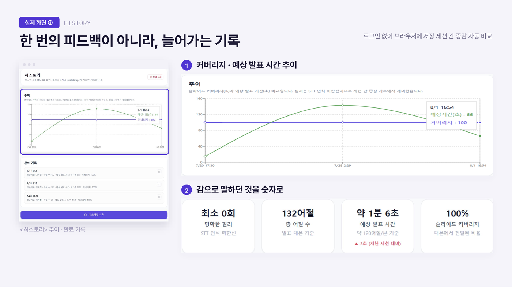
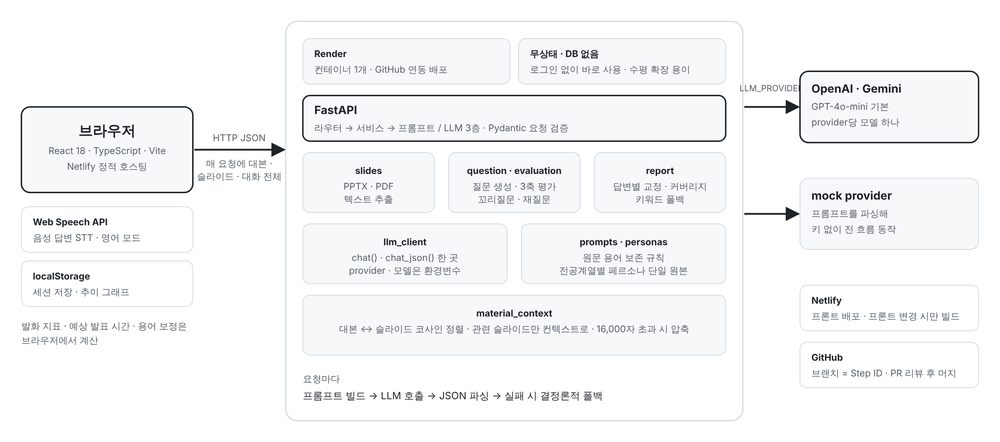
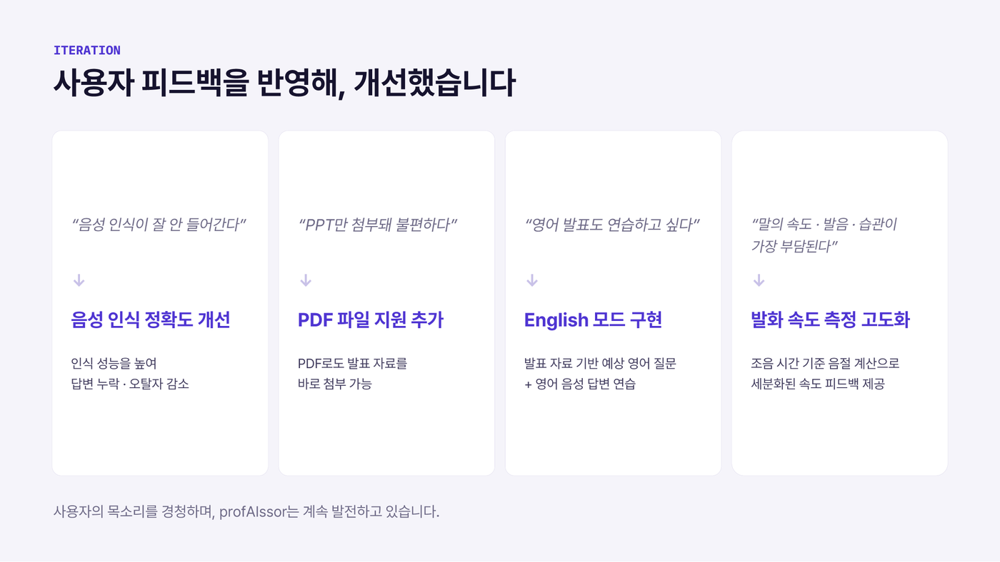

# profAIssor
> **발표·구술시험 질의응답 연습 서비스**
> 
> 발표 자료를 올리면 AI가 교수·동료·일반 청중 역할로 질문하고, 답변에 꼬리 질문을 이어가며, 끝나면 피드백 리포트를 주는 웹 서비스
> 
> 제3회 숭실 재학생 학습법 경진대회(AX 인터랙티브 공모전) **최우수상**

- 기간: 2026.07 – 2026.08
- 팀: 3인
- 스택: Python · FastAPI / React 18 · TypeScript · Vite · Tailwind / OpenAI API / Render · Netlify
- 배포: <https://profaissor.netlify.app> (Chrome 권장)

<br>

## 팀 · 역할

| 담당 | 내용 |
|---|---|
| [@cl-o-lc](https://github.com/cl-o-lc) | OpenAI 연동, 난이도·최대 턴·rubric, 전공계열별 페르소나, STT 용어사전 보정, 마이크 권한 UX, PPT 추출·업로드, 세션 저장·히스토리 화면·그래프, 리포트 답변별 상세 교정 |
| [@raswsdf](https://github.com/raswsdf) | provider별 단일 모델 정리, 질문 흐름·꼬리질문·답변불가 재질문 고도화, 음성 기반 스파링·발화 속도 지표, 영어 음성 질문·답변, 페르소나 정의 백엔드 단일화, 질문·평가·리포트 도메인 모듈 분리 |
| [@NANOliberty](https://github.com/NANOliberty) | 예선 MVP 백엔드·프론트 초기 구조, LLM provider 추상화, 슬라이드 커버리지 키워드 폴백, 슬라이드별 누락 유형 구체화(3-3), Render 배포·CORS, PDF 업로드, 스파링 UX, 히스토리 정리 |

<br>

## 동작 과정

<table>
<tr>
<td></td>
<td></td>
</tr>
<tr>
<td align="center">셋업 — 자료 업로드 · 페르소나 · 난이도</td>
<td align="center">스파링 — 질문 → 음성 답변 → 3축 평가 → 꼬리질문</td>
</tr>
<tr>
<td></td>
<td></td>
</tr>
<tr>
<td align="center">리포트 — 모범답안 · 슬라이드 커버리지</td>
<td align="center">히스토리 — 세션 추이</td>
</tr>
</table>

<br>

## 시스템 구성



<br>

## 구조

```
presentation-sparring/
├── backend/                  FastAPI
│   ├── main.py               앱 진입, CORS, 라우터 등록
│   ├── llm_client.py         provider 추상화 — openai / gemini / mock, chat() · chat_json()
│   ├── routers/              slides · personas · questions · evaluate · followup · report
│   ├── services/             question · evaluation · report 도메인 로직
│   ├── prompts.py · report_prompt.py · core/prompt_rules.py   프롬프트
│   ├── material_context.py   대본 ↔ 슬라이드 정렬(코사인 유사도), 컨텍스트 압축
│   ├── ppt_extract.py · pdf_extract.py   업로드 → 슬라이드 텍스트
│   ├── personas.py           페르소나 정의 (단일 원본)
│   └── speech_metrics.py     필러 단어 · 말속도
└── frontend/                 React + Vite
    ├── src/components/       Setup · Spar · Report · History 화면
    ├── src/hooks/            useSpeechRecognition · useMicMetrics
    └── src/lib/              sessionStore · termCorrection · coverage · speechMetrics
```

<br>

## 설계에서 결정한 것들

### LLM 호출을 한 곳에 — `llm_client.py`

서비스 코드는 `chat()` / `chat_json()`만 부르고, 어떤 모델을 쓰는지는 `.env`의 `LLM_PROVIDER`로 결정
provider는 `openai` / `gemini` / `mock` 셋이고 각각 환경변수에 지정한 모델 하나만 사용. 페르소나(교수·동료·청중)는 질문 관점과 표현만 바꾸며 상위 모델로 라우팅하지 않음

`mock`은 API 키 없이 셋업 → 스파링 → 리포트가 끝까지 도는 고정 응답 — 화면·API 연결을 키 없이 검사하고, 시연 중 외부 장애에 대비 가능

### 슬라이드 누락과 키워드 폴백 — 슬라이드 커버리지

- LLM이 판정하지 않은 슬라이드는 `_fallback_coverage()`가 키워드 오버랩으로 결정론적 판정 — 슬라이드 키워드 중 대본에 없는 비율이 50% 넘으면 미전달
- 미전달 시 누락 유형을 수치(숫자·%)인지 용어인지 구분해서 리포트에 구체적으로 표시
- 결과: 리포트에 모든 슬라이드가 항상 나타남. LLM 실패가 사용자에게 빈 칸으로 보이지 않음

### 대본 ↔ 슬라이드 정렬 — `material_context.py`

긴 대본을 통째로 프롬프트에 넣으면 토큰이 낭비되고 질문이 특정 슬라이드에 집중되지 않음. 대본을 문단으로 나눠 각 슬라이드와 코사인 유사도로 정렬하고, 질문 생성 시 관련 슬라이드만 컨텍스트로 선택. 16,000자 넘는 대본은 압축

### 음성은 브라우저에서

STT는 Web Speech API, 말속도·필러 측정은 프론트, 서버는 텍스트만 받음
미지원 브라우저에선 🎙 버튼이 숨겨지고 타이핑으로 동작
전공 용어 오인식은 `termCorrection.ts` 사전으로 보정

<br>

## 로컬 실행

```bash
# 백엔드 (포트 8000)
cd presentation-sparring/backend
python3 -m venv .venv && source .venv/bin/activate
pip install -r requirements.txt
cp .env.example .env          # 기본 LLM_PROVIDER=mock — 키 없이 바로 실행
uvicorn main:app --reload --port 8000

# 프론트 (포트 5173)
cd presentation-sparring/frontend
npm install && npm run dev
```

`backend/.env`

```dotenv
LLM_PROVIDER=mock             # openai | gemini | mock
OPENAI_API_KEY=
OPENAI_MODEL=gpt-4o-mini
GEMINI_API_KEY=
GEMINI_MODEL=gemini-3.1-flash-lite
```

<br>

## API

| 경로 | 내용 |
|---|---|
| `POST /api/slides/extract` | pptx / pdf 업로드 → 슬라이드별 텍스트 (PDF 1페이지 = 슬라이드 1개) |
| `GET /api/personas` | 전공계열별 페르소나 목록 |
| `POST /api/questions` | 대본·슬라이드·페르소나·난이도 → 질문 생성 |
| `POST /api/evaluate` | 답변 평가 → 점수·꼬리 질문 여부 |
| `POST /api/followup` | 답변 불가 시 재질문 |
| `POST /api/report` | 전체 transcript → 축별 총평·답변별 교정·슬라이드 커버리지·음성 지표 |
| `GET /api/health` | Render 헬스체크 |

<br>

## 배포

- 백엔드: Render (`render.yaml`) — `LLM_PROVIDER=openai`, 키는 대시보드에서 `sync: false`
- 프론트: Netlify (`netlify.toml`) — 프론트 변경 없는 push는 빌드 스킵

<br>

## 사용자 테스트 (2026.07.19–21)

재학생 5명, 구글 폼 25문항

| 피드백 우선순위 | 반영 |
|---|---|
| 음성 인식 정확도 | 전공 용어사전 보정, 조음 시간 기준 발화 속도 계산 |
| 질문 난이도 상향 | 난이도 단계·rubric, 꼬리질문 턴 분리 |
| PDF 업로드 | `pdf_extract.py` 추가 |
| 리포트 진입 조건 | 스파링 완료 후에만 리포트 열림 |
| 영어 발표 연습 | English 모드 — 영어 질문·영어 음성 답변 |



<br>

## 한계

- 모바일 레이아웃 미정리 (PLAN Phase 5 미착수)
- 세션이 localStorage라 기기 간 공유 불가
- 슬라이드 커버리지 폴백은 키워드 일치 기준, 같은 뜻을 다른 말로 한 경우 미전달로 판정될 수 있음

<br>

## 자료

- [발표 자료 (PDF, 10쪽)](docs/profAIssor_발표자료.pdf) — 문제 정의 · 동작 · 실제 화면 · 사용자 테스트 · 이터레이션

<br>

## 협업 방식

[`PLAN.md`](presentation-sparring/PLAN.md) — Phase / Step 단위 로드맵, 브랜치명 = Step ID, PR 1인 승인 후 머지, 체크리스트에 담당자 표기
